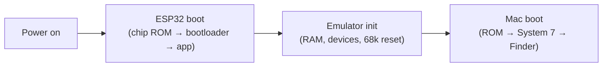
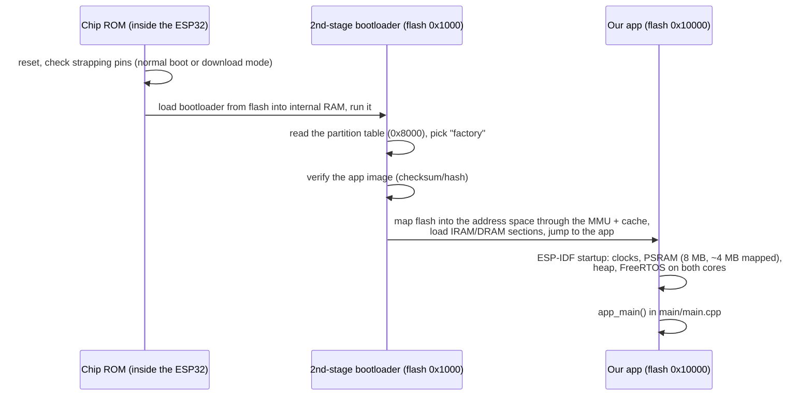
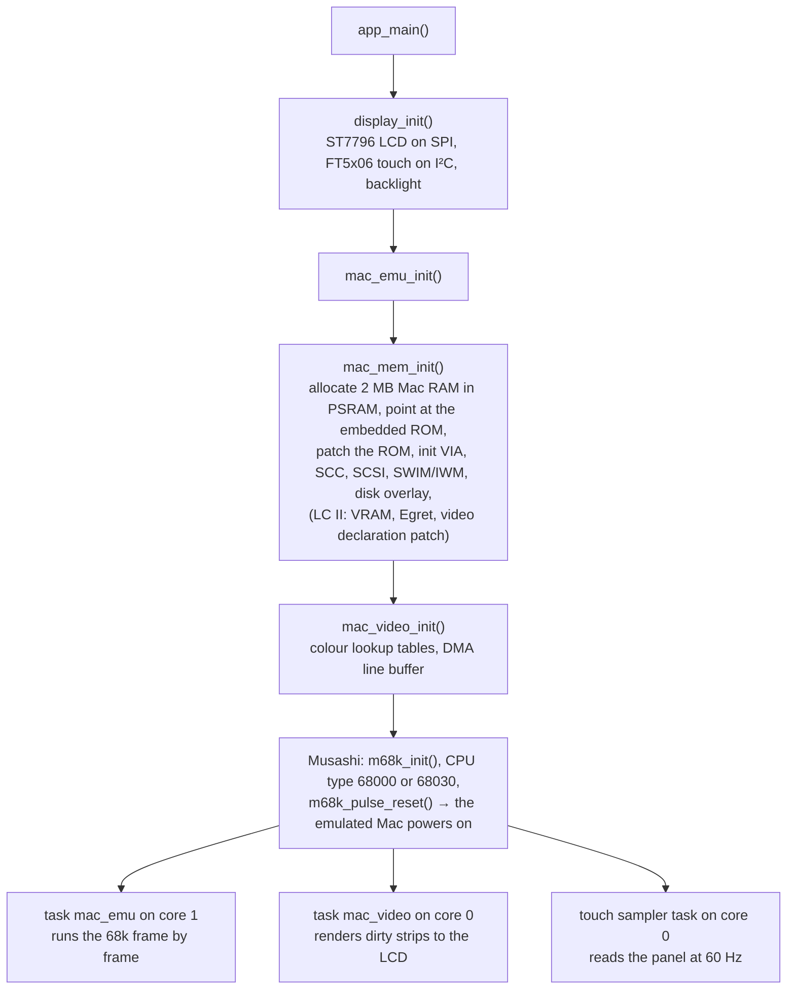
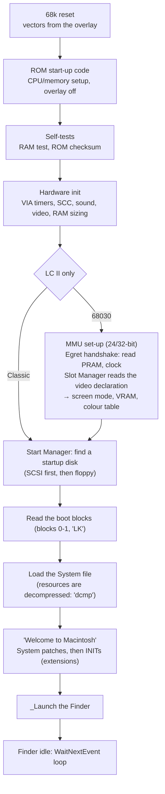
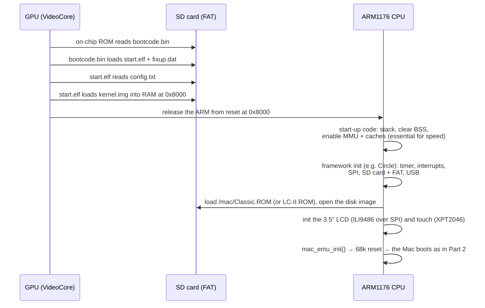

# 8. How everything boots — three boots, explained with diagrams

Turning on the board starts **three different boots**, one inside the other:

1. the **ESP32** boots its firmware (chip ROM → bootloader → our app);
2. our app powers on an **emulated Macintosh**, which boots like a real one
   (68k reset → Mac ROM → System 7 → Finder);
3. (planned) on a **Raspberry Pi 1**, the GPU boots first and then starts our
   emulator as a bare-metal `kernel.img`.



---

## Part 1 — The ESP32 boot

### The flash layout (4 MB)

```
 flash address
 0x000000 ┌────────────────────────────┐
          │ (reserved)                 │
 0x001000 ├────────────────────────────┤
          │ 2nd-stage bootloader       │  ← from ESP-IDF
 0x008000 ├────────────────────────────┤
          │ partition table            │  ← partitions.csv
 0x009000 ├────────────────────────────┤
          │ nvs        (24 KB)         │  settings storage (unused today)
 0x00F000 ├────────────────────────────┤
          │ phy_init   (4 KB)          │  radio calibration
 0x010000 ├────────────────────────────┤
          │ factory app (3.94 MB)      │
          │  ├ emulator code (~1.1 MB) │  executed in place via the cache
          │  ├ Mac ROM     (512 KB)    │  embedded as read-only data
          │  └ disk image  (≤2.88 MB)  │  embedded as read-only data
 0x400000 └────────────────────────────┘
```

### From power-on to our code



Two things worth noticing:

- **The app runs straight out of flash ("execute in place").** Only the hottest
  code is copied into fast internal IRAM; everything else, including the Mac ROM
  and the disk image, is read through the same small 32 KB cache. This is why
  cache behaviour dominates performance ([chapter 1](01-hardware-esp32.md),
  [chapter 4](04-performance.md)).
- **The bootloader verifies the whole app image.** That is why the embedded disk
  can't be written in place: changing any byte would make the board refuse to
  boot. Saved files live in a PSRAM overlay instead.

### Inside `app_main()` — starting the emulator



From here on, **core 1 is the Macintosh**: `mac_emu_run()` executes 68k
instructions in time slices, ticks the emulated chips, and once per frame
(1/60 s of Mac time) raises the vertical-blank interrupt.

---

## Part 2 — The emulated Mac boots

### Step 0: the 68000 reset trick (the "overlay")

On reset a 68000/68030 reads its first stack pointer and program counter from
**address 0**. But address 0 is RAM, which is empty at power-on. Macs solve
this with an **overlay**: right after reset, the ROM is *also* visible at
address 0, so the CPU finds its reset vectors there. The ROM then jumps to its
real address and switches the overlay off, revealing RAM at 0.

```
   right after reset (overlay ON)          after the ROM switches it off
   ┌───────────────┐ 0x000000              ┌───────────────┐ 0x000000
   │  ROM (mirror) │ ← CPU reads SSP + PC  │  RAM          │ ← vectors, globals,
   │               │                       │  (2 MB)       │   System, apps
   ├───────────────┤                       ├───────────────┤
   │  …            │                       │  …            │
   │  ROM (real)   │ Classic $400000       │  ROM (real)   │ Classic $400000
   │               │ LC II   $A00000       │               │ LC II   $A00000
   └───────────────┘                       └───────────────┘
```

| | Mac Classic | LC II |
|---|---|---|
| Reset PC | `$0040002A` (absolute, in ROM) | `$0000002A` (in the overlay mirror) |
| Overlay switched off by | the first write to VIA port A | the first access to the real ROM window `$A00000` |

Getting this rule wrong for the LC II was one of the biggest early bugs: using
the Classic rule removed the ROM from under the running code
([chapter 6](06-lessons-learned.md)).

### The whole Mac boot



### Where the emulator steps in

A real Mac does all of the above by itself. Our emulator lets the real ROM and
System run, but helps at specific points — these are the most instructive
places to read the code:

| Boot stage | What the emulator does | Why | Code |
|---|---|---|---|
| Self-tests | Classic: patches skip the RAM test and ROM checksum; LC II: runs them natively in C | Speed; our ROM copy is patched, so its checksum would fail | `mac_memory.c` ROM patches, `mac_native.c` ROM loops |
| Screen set-up | Classic: 5 ROM patches report 480×320; LC II: the video declaration (VPBlocks) is patched to 480×320 | The LCD is 480×320; pixels map 1:1 | `mac_memory.c`, `mac_v8video.c` |
| PRAM / clock | Classic: RTC chip emulation; LC II: Egret/Cuda emulation | Valid settings (no AppleTalk alert), a ticking clock | `mac_rtc.c`, `mac_egret.c` |
| MMU (LC II) | PMOVE/PLOAD/PFLUSH handled, no translation | The ROM's tables map addresses 1:1 anyway; translation would cost speed | `components/musashi/m68kmmu.h` |
| Startup disk search | PRAM byte `$01` = 1 s SCSI wait instead of 20 s | No SCSI disks are emulated | `mac_egret.c` |
| Disk reads | The floppy driver's read/write calls are served straight from the disk image | Faster and simpler than emulating the floppy's bit stream | `mac_memory.c` (Classic), `mac_v8disk.c` (LC II), `mac_disk_overlay.c` |
| System resources | `dcmp` decompression runs natively in C | 33–65% of boot instructions | `mac_native.c` |
| Every trap call | The A-line trap dispatcher runs natively | 15–17% of all instructions | `mac_native.c` |
| Finder idle | Busy-wait loops are fast-forwarded to the next tick | ~90% of idle work is waiting | `mac_emulator.c` (idle fast-forward) |

---

## Part 3 — Planned: the Raspberry Pi 1 bare-metal boot

On a Raspberry Pi the **GPU** (VideoCore) starts first; the ARM CPU stays
asleep until the GPU firmware has loaded our program. There is no operating
system: `kernel.img` *is* the emulator. See the full plan in
[`spec/raspberry-pi-port.md`](../../spec/raspberry-pi-port.md).



The SD card for the Pi:

```
SD card (FAT32)
├── bootcode.bin, start.elf, fixup.dat   Raspberry Pi firmware
├── config.txt                           firmware settings (kernel name, clocks)
├── kernel.img                           our emulator, built with arm-none-eabi-gcc
└── mac/
    ├── Classic.ROM, LC-II.ROM           your ROMs
    ├── custom_753.dsk, *.dsk            your disk images (writable here!)
    └── config.txt                       which ROM + disk to boot
```

---

## The three boots side by side

| | ESP32 board | Emulated Mac | Raspberry Pi 1 (planned) |
|---|---|---|---|
| First code to run | chip ROM inside the ESP32 | the Mac ROM's reset vector (via the overlay) | GPU on-chip ROM |
| Loads the next stage from | flash (bootloader at 0x1000) | ROM → boot blocks on the disk | SD card (bootcode.bin → start.elf) |
| Our code starts at | `app_main()` | — (the Mac runs Apple's code) | `kernel.img` at `0x8000` |
| Where the "disk" lives | embedded in flash | the disk image, served by our hooks | a file on the SD card |
| Operating system | FreeRTOS (2 cores) | System 7.5.3 (emulated) | none (bare metal) |
| What you can learn here | XIP flash, caches, partitions | overlay, ROM init, boot blocks, INITs | GPU-first boot, bare-metal start-up, MMU/caches |

Next: re-read [chapter 2](02-emulated-macs.md) for the machines' address maps
and [chapter 3](03-cpu-emulation.md) for how the 68k is executed.
