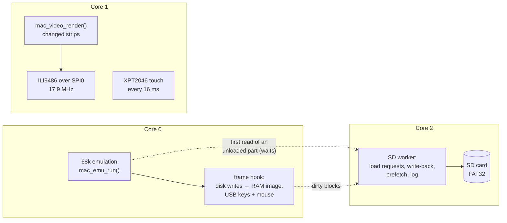

# 9. The Raspberry Pi 2 port — the same Mac on four cores, without an OS

The emulator core was written for an ESP32, but almost none of it depends on
the ESP32. This chapter shows how it was moved to a **Raspberry Pi 2** running
**bare metal** (no Linux): what had to be written, how the four ARM cores share
the work, and what went wrong on the way. Set-up instructions are in
[`ports/rpi/README.md`](../../ports/rpi/README.md); the boot sequence is
explained in [chapter 8](08-boot-explained.md), part 3.

## 1. Porting by shims, not by rewriting

The PC host harness ([chapter 7](07-host-harness.md)) had already proved the
idea: compile `main/*.c` and Musashi unchanged and replace the few ESP-IDF calls
with small shims. The Pi port reuses the trick with a third set of shims
(`ports/rpi/macemu/shim/`):

| ESP-IDF | Pi (Circle) |
|---|---|
| `esp_timer_get_time()` | the 1 MHz system timer |
| `ESP_LOGx` | Circle's logger (HDMI, serial, a RAM buffer saved to the card) |
| `heap_caps_malloc` | `malloc` (1 GB of SDRAM, no PSRAM) |
| `vTaskDelay`, `taskYIELD` | busy delay; the per-frame hook |
| `display_draw`, `display_get_touch` | ILI9486 and XPT2046 drivers |
| ROM + disk symbols in flash | files on the SD card (`MAC_EXTERNAL_IMAGES`) |

[Circle](https://github.com/rsta2/circle) provides the bare-metal basics: MMU
and caches, interrupts, SPI, the SD card with FatFs, USB, and starting the
other cores. The C library comes from the Arm toolchain's newlib, with a few
system-call stubs (`syscalls.c`).

Everything the core needed for the Pi is behind switches that default to the
ESP32 behaviour (`MAC_EXTERNAL_IMAGES`, `MAC_KEYBOARD`, `MAC_DRIVE2`,
`MAC_BOOT_TURBO`, a `disk_ov_fill` hook that is NULL on the ESP32), so the ESP32
firmware builds and behaves exactly as before. That rule was kept for every
change.

## 2. The display: the limit is in the shift registers

The 3.5" display is not an SPI display at all: its ILI9486 controller has a
16-bit parallel bus, fed by two 74HC4094 shift registers and a 74HC4040 counter
that strobes WR every 16 clocks. So every transfer is a 16-bit word and the bus
is write-only. The first test (`ports/rpi/r1-display`) measured each SPI clock
the Pi can make (250 MHz / even divider):

| Clock | Result |
|---|---|
| 15.6 MHz | clean, 6.3 fps full screen |
| **17.9 MHz** | **clean, 7.2 fps** |
| 20.8 MHz and up | pixels dropped (a colour ramp broke into shifted segments) |

A plain colour fill hides dropped pixels; only an image with structure (the
ramp) showed them. Other units of the same design are reported to reach
22–32 MHz: the limit is the individual board. 7 fps for a *full* redraw is
fine because the renderer only sends the 20-line strips that changed.

## 3. Four cores instead of two tasks

On the ESP32, core 1 runs the Mac and core 0 renders. The Pi has four cores:

- **Core 0** runs the 68k and owns interrupts and USB.
- **Core 1** renders and samples touch. It is the only core using SPI0, which
  the display and the touch controller share (the touch chip needs a slow
  1.95 MHz clock, so each side sets the clock before its transfer).
- **Core 2** does *all* SD card access once the Mac runs (below).

The cores share memory through the caches (Circle's `ARM_ALLOW_MULTI_CORE`
marks memory shareable); hand-overs use simple sequence counters and data
memory barriers.

## 4. Disks on the SD card

The ESP32 keeps its disk in flash and loses changes at power-off. On the Pi
the disk images are files, so changes can be kept:

1. **On demand.** An image is allocated in RAM but not read. The core's disk
   overlay calls `disk_ov_fill(offset, count)` before it touches image bytes;
   the platform then loads the missing 1 MB chunks. Boot only touches a few
   megabytes of a 50 MB System disk.
2. **Prefetch.** In the background core 2 reads the rest, 64 KB at a time,
   until the whole image is in RAM.
3. **Write-back.** The Mac's writes land in the overlay (drive 1) or directly
   in the image (drive 2). Changed 512-byte blocks are marked dirty (one byte
   per block, so two cores never update the same byte), and core 2 writes them
   to the file a second after the Mac stops writing, and before a restart.

**FatFs is not thread-safe**, so after start-up only core 2 calls it. When
the Mac needs a chunk that is not loaded yet, core 0 posts a request and waits;
everything else (prefetch, saving, the log) happens without the Mac noticing.

### A second drive on a one-drive Mac

The LC II has a single floppy drive. To mount a second disk, the emulator does
what a driver would do: at the Finder's next `WaitNextEvent` (a safe point,
found through the A-line trap hook), it runs a 40-byte 68k routine that it
serves from an unused bus window ($FE0040): `_NewPtrSysClear` for a drive
queue element, `_AddDrive` as drive 2 of the floppy driver, `_PostEvent`
(diskEvt). The system mounts the volume; reads and writes for drive 2 reach a C
callback through the existing floppy Prime hook (`MAC_DRIVE2`, `mac_v8disk.c`).

## 5. Keyboard: a real ADB keyboard on the LC II

USB keyboards report HID usage codes; the Mac wants ADB key codes. The Pi
translates (Alt = Option, Windows key = Command, Caps Lock as a locking key)
and the core takes them two ways (`mac_kbd.c`, `MAC_KEYBOARD`):

- **LC II:** the emulated Egret gets an ADB keyboard at address 2. The ROM
  finds it during ADB address resolution, and the Mac's own driver does the
  rest: key maps, KeyMap, auto-repeat.
- **Classic:** the emulator has no ADB bus, so it mirrors what the ROM's ADB
  keyboard handler does (KeyMap, KeyLast, the auto-key message, `_PostEvent`)
  with a built-in US layout; the system's own GetOSEvent then repeats keys.

The host harness can type (`--type`, `--key`), which made both testable on the
PC: Command-N and a name create a named folder on both machines.

## 6. Speed

- **Turbo boot** (`MAC_BOOT_TURBO`): no real-time cap until the Finder is up;
  the Pi was only ~10% busy at real-time speed.
- **Full LC II CPU** (`MAC_V8_CYCLE_SCALE=1`): the ESP32 gives the 68030 half
  its cycles per frame to keep up; the Pi does not need to.
- **8 MB on the LC II** so a full System 7.5.3 and big applications fit.
- **Lean System.** A full System Folder copied from an old Mac had desktop toys
  (eyes following the mouse, an animated character), a screen saver, network
  and file-sharing services and many patches. The profiler showed
  `SystemTask` at 11,000 instructions per call; moving 25 items to the
  "(Disabled)" folders (`tools/split_disk.py --disable`) cut idle CPU by a
  third and boot time by 2.3×.

## 7. Lessons learned

- **Build diagnostics into the device early.** Without HDMI the Pi showed only
  a black screen. A log tee saved to the SD card, a red freeze strip with the
  stuck 68k PC (drawn by core 1), and numbered error screens turned every "it
  does not work" into a concrete line in a file.
- **Check the storage before the code.** Hangs, a boot loop and corrupted
  reads all came from one cause: a fake "2 GB" SD card that really stored
  about 128 MB. Comparing the card's copy with the original, block by block,
  showed the data turning into `FF` bytes at the same offset every time.
- **Large direct reads hung in the SDHOST driver** while USB was busy. Reading
  in 64 KB pieces through a static buffer, and finally switching Circle to its
  EMMC driver (`NO_SDHOST`), fixed it.
- **A slow game can be a maths bug.** One game spent 99.8% of its time in
  `floatx80_div`: 68881 "unnormal" operands made the software divide loop for
  seconds per call. Normalising them, as the real FPU does, made it 300× faster
  (on the ESP32 too).
- **Old games and System 7.** A 1987 game draws over the whole screen without
  a window; when it quits nothing repaints the desktop. The emulator now calls
  `PaintBehind` + `DrawMenuBar` once after a full-screen game quits
  (`MAC_QUIT_REPAINT`).
- **Measure with the profiler, not by feel** — the same lesson as on the ESP32
  ([chapter 4](04-performance.md)), and it held every time.
